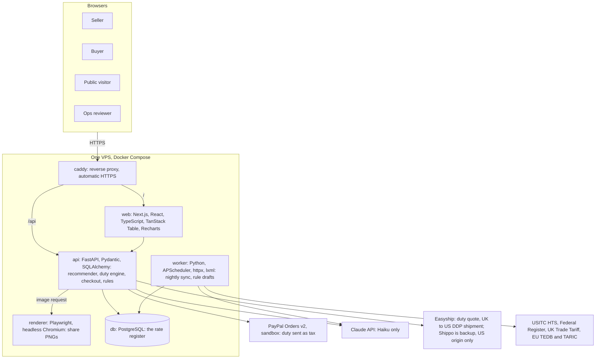

# Landfall: solution architecture

One VPS, Docker Compose, six containers, four images built in CI. This is the text version of the diagram in the HLD (https://claude.ai/artifact/DReaMKj5Ti6o4y9nGob7KD).

## Rules the architecture depends on

- Checkout never calls the model. It reads accepted classifications and the rate register only.
- Every price is a register read at a stated date. Orders lock the register version they used.
- Only `caddy` publishes ports (80, 443). Everything else is on a private Docker network.
- Secrets live in a protected `.env` on the server, never in images or git.
- The database is on a named volume; a nightly `pg_dump` is copied off the VPS.
- CI builds four images (web, api, worker, renderer); the VPS pulls them and runs `docker compose up -d`.
- VPS size: 4 GB RAM or more (Chromium in the renderer needs about 1 GB).
- Licences: permissive only. CI fails the build on copyleft or source-available licences.
